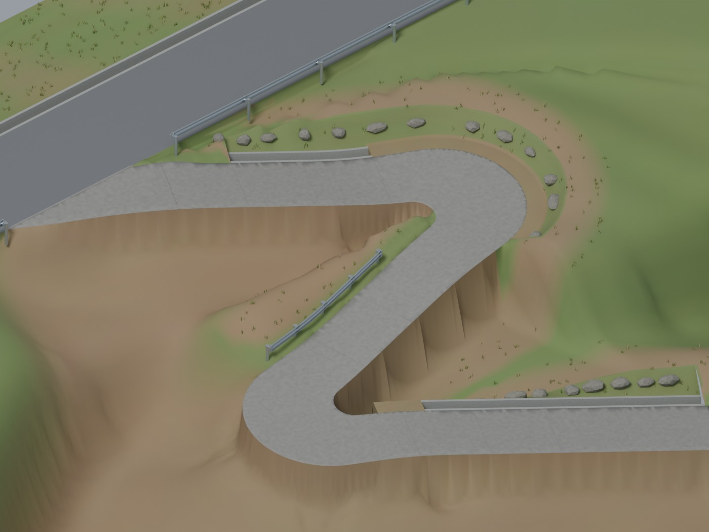

# BeamNG 道路模型项目

根据手绘布局制作的 Blender 双发卡弯道路，另有独立的中国科目二项目目录。

- [道路项目成果索引](output/mountain_hairpin_road/README.md)
- [Blender 与 BeamNG 工作流程](docs/BLENDER_BEAMNG_WORKFLOW.md)
- [中国科目二项目](output/china_subject2/README.md)

## 当前版本

最新导入包为 [BeamNG V3](output/mountain_hairpin_road/beamng_hairpin_test_v3/README.md)，已同步 V20 的道路宽度、护栏、悬崖和排水渠退让，并修复隐藏护栏碰撞体的位置；已完成离线检查，待 Windows 游戏验证。

当前 Blender 为 [V20：大路 5 米与排水渠退让](output/mountain_hairpin_road/blender_trial_v20_main5m_drain_setback/README.md)。大路净铺装加宽到 5 m；小路保持 3 m，上方排水渠止于 C1 入弯前 2 m，下方渠始于 C2 出弯后 4 m。

上一版为 [V19：小路 3 米与大路双车比例](output/mountain_hairpin_road/blender_trial_v19_width_3m/README.md)。小路两侧各加宽 7.5 cm，排水渠与路侧设施同步外移；大路实测净铺装 4.5 m，不含排水渠，附两辆真实尺寸 C63 的俯视对照。

上一版为 [V18：收短弯道口护栏](output/mountain_hairpin_road/blender_trial_v18_short_guardrail/README.md)，靠 C1 的端头收回约 3.5 m，保留约 7 m 护栏。

上一版为 [V17：下方直路追加排水渠](output/mountain_hairpin_road/blender_trial_v17_lower_drain/README.md)，在红色箭头所指土坡侧新增同规格沟渠。

上一版为 [V16：护栏、悬崖坎与排水渠](output/mountain_hairpin_road/blender_trial_v16_roadside_layout/README.md)，按用户三处标注更新小路路侧。

上一版宽度试调为 [V15：小路宽 2.85 m](output/mountain_hairpin_road/blender_trial_v15_width_285/README.md)，包含 C63 发卡弯同角度俯视图；另有[小路直段居中俯视图](output/mountain_hairpin_road/c63_straight_preview_285/README.md)。**现有 BeamNG V2 仍使用 2.7705 m 旧宽度，本轮未重新打包。**

上一版为 [Blender V14：用户提供的 C63 参考车](output/mountain_hairpin_road/blender_trial_v14_c63_reference/README.md)，道路环境沿用 [V12](output/mountain_hairpin_road/blender_trial_v12_driving_edges/README.md)，对应 [BeamNG 驾驶测试包 V2](output/mountain_hairpin_road/beamng_hairpin_test_v2/README.md)。V13/V14 仅替换展示车辆，地图包无需重新生成。

**已完成离线格式、几何和碰撞配置检查，尚未在 Windows BeamNG 中加载或驾驶验证。**

| 项目 | 当前模型 |
| --- | --- |
| 大路 | 5.0 m（不含排水渠）、水平、无中心线灰色柏油 |
| 小路 | V19 试调 3.00 m 旧水泥路面，弯内局部补角 |
| 坡度 | 直路约 10°；两弯平均约 3°、轻微内倾，各 5 m 接坡 |
| 路侧 | 中间直段一侧约 7 m 波形护栏、另一侧无防护陡坎；上方/C1 及下方直路土坡侧先接 0.5 m × 0.6 m 排水渠 |
| 悬崖侧 | 无防护陡降路缘，无挡坎和护栏 |
| 大路设施 | 靠小路侧波形钢护栏；另一侧净宽 0.5 m、深 0.6 m 排水渠 |
| 参考车 | 用户提供的 C63，校正为 4.756 × 1.839 × 1.426 m、轴距 2.840 m、含后视镜宽 2.020 m；不作为游戏车辆导出 |

## 测试包与安装

- [V3 测试 ZIP](output/mountain_hairpin_road/beamng_hairpin_test_v3/tight_hairpin_drive_v3.zip)
- [旧 V2 测试 ZIP](output/mountain_hairpin_road/beamng_hairpin_test_v2/tight_hairpin_drive_v2.zip)
- [Windows 导入与试车说明](output/mountain_hairpin_road/beamng_hairpin_test_v3/Windows导入与试车说明.txt)
- [Blender V20 场景（本地）](output/mountain_hairpin_road/blender_trial_v20_main5m_drain_setback/road_trial_v20_main5m_drain_setback.blend)
- [Blender V19 场景（本地）](output/mountain_hairpin_road/blender_trial_v19_width_3m/road_trial_v19_width_3m.blend)
- [Blender V18 场景（本地）](output/mountain_hairpin_road/blender_trial_v18_short_guardrail/road_trial_v18_short_guardrail.blend)
- [Blender V17 场景（本地）](output/mountain_hairpin_road/blender_trial_v17_lower_drain/road_trial_v17_lower_drain.blend)
- [Blender V16 场景（本地）](output/mountain_hairpin_road/blender_trial_v16_roadside_layout/road_trial_v16_roadside_layout.blend)
- [Blender V15 场景（本地）](output/mountain_hairpin_road/blender_trial_v15_width_285/road_trial_v15_width_285.blend)
- [Blender V14 场景（本地）](output/mountain_hairpin_road/blender_trial_v14_c63_reference/road_trial_v14_c63_reference.blend)
- [独立 C63 参考车（本地）](output/mountain_hairpin_road/blender_trial_v14_c63_reference/mercedes_amg_c63_reference.blend)
- [上一版 A4L 参考车](output/mountain_hairpin_road/blender_trial_v13_a4l_reference/README.md)

C63 源素材页面标示个人使用许可；原始模型及衍生 `.blend` 已从公开 Git 跟踪中排除，仅保留本地。预览与来源记录见 V14 文档。

1. 将 V3 ZIP 复制到 Windows，不解压。
2. BeamNG 启动器选择 **Manage User Folder → Open in Explorer**，将 ZIP 放入用户目录的 `mods`。
3. 在 Freeroam 搜索 **Hometown Hairpin Drive V3**，选择 Main Road 出生点。
4. 使用游戏内车辆，依次检查中线低速通过、土坡侧撞石、悬崖侧落轮、护栏和排水渠碰撞。

石块与土坎属于实体碰撞；草丛和切缝没有碰撞；护栏外观与简化碰撞体分开。约 5.4 万个物理三角面。真实道路数据和路面摩擦尚未校准，Blender 参考车不代表动态车辆表现。

## 历史版本

旧 [V1 地图包](output/mountain_hairpin_road/beamng_hairpin_test_v1/) 对应 Blender V9：大路 4 m、小路 2.775 m，尚无后续弯道缓坡和路缘石块。V2 使用独立地图目录，可区分版本；建议停用旧包以免选错。

此前公开的 V1 下载：[GitHub ZIP](https://github.com/NanoBei/beamng-blender/raw/refs/heads/main/output/mountain_hairpin_road/beamng_hairpin_test_v1/tight_hairpin_test_v1.zip)。仓库归档 V10–V20 的可公开文件及 V2/V3 测试包；C63 原始与衍生 Blender 文件仅本地保存。
