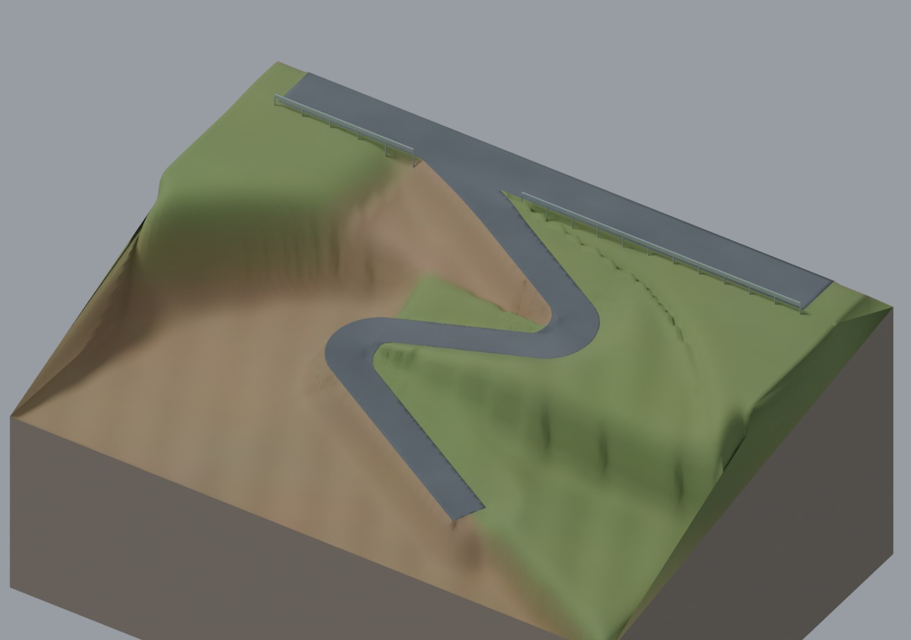

# BeamNG 双发卡弯测试地图

根据手绘道路布局制作的 Blender 道路模型，现提供首版 BeamNG.drive 测试导入包。

**当前状态：已完成离线文件与几何检查，尚未在 BeamNG 内加载或驾驶验证。**

## 下载

- [下载地图 ZIP（约 2.7 MB）](https://github.com/NanoBei/beamng-blender/raw/refs/heads/main/output/beamng_hairpin_test_v1/tight_hairpin_test_v1.zip)
- [Windows 中文导入说明](output/beamng_hairpin_test_v1/Windows导入说明.txt)



## 安装

1. 将上面的地图 ZIP 复制到 Windows 电脑，**不要解压**。请下载地图包，不要用 GitHub 的“Code → Download ZIP”代替。
2. 在 BeamNG 启动器选择 **Manage User Folder → Open in Explorer**。
3. 将地图 ZIP 放进打开的用户文件夹下的 `mods` 文件夹。
4. 启动游戏，确认模组已启用；在 **Freeroam** 搜索 **Tight Hairpin Test**，选择 **Main Road** 出生点。

不需要安装 Blender、Python 或 Blender MCP。安装方式参考 [BeamNG 官方说明](https://documentation.beamng.com/tutorials/mods/installing-mods/)。

## 地图参数

| 项目 | 当前版本 |
| --- | --- |
| 大路 | 宽 4 米，水平 |
| 小路 | 直线宽 2.775 米 |
| 坡度 | 入口约 6 米过渡至中心线下坡 10°，之后约 10° |
| 发卡弯 | 两处，内侧局部补角，内圆角半径 1 米 |
| 末端直线 | 16 米 |
| 护栏 | 仅大路靠小路一侧，两段直护栏 |
| 地块范围 | 约 50 × 37 米 |

10° 指中心线纵坡，并非所有路面三角面的坡度。发卡内侧存在更陡的局部面，需在游戏中检查跳动、蹭底和悬轮。

测试包包含静态道路、土坡、植被颜色贴图、护栏、碰撞、天空和车辆出生点。展示用蓝色尺寸参考车不在包内，请使用游戏内车辆测试。护栏为静态碰撞物；本版不含 AI 路网、任务或额外车辆模组。

## 验证与限制

已检查 DAE 独立解析、三角网格与朝向、平坦大路、出生点路面支撑、材质路径、JSON 和 ZIP 完整性。游戏版本兼容性、实际抓地、悬架表现和帧率仍需 Windows 实测。

地图 ZIP 的 SHA-256：

```text
f6e7a5c98b75391f81bbe6ca823cd18305e2aa61bcf7e87e9667e000e99e1f2f
```

`output/road_plan_v5_tight35/` 保存早期确认的平面图；游戏包以其后调整的 Blender V9 模型为准。
